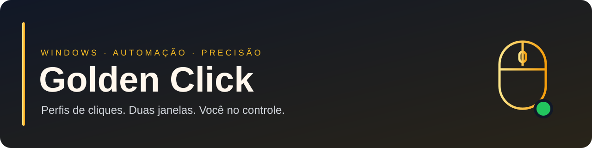

# Golden Click

**Perfis de cliques. Duas janelas. Você no controle.**

[**BAIXAR INSTALADOR**](https://github.com/Codinome007/golden-click-releases/releases/latest/download/Golden_Click_Instalador_Windows11_x64.zip) · [**VERSÃO PORTÁTIL**](https://github.com/Codinome007/golden-click-releases/releases/latest/download/Golden_Click_Portatil_Windows11_x64.zip)

## Escolha como usar

| Pacote | Como funciona |
| --- | --- |
| **Instalador** | Instala em `C:\Golden Click` e cria um atalho na Área de Trabalho. |
| **Portátil** | Extraia em uma pasta gravável e abra `GoldenClick.exe`. Não exige instalar o .NET separadamente. |

Os arquivos de download ficam nas **[Releases](https://github.com/Codinome007/golden-click-releases/releases)**. Este repositório distribui os executáveis, instruções e identidade visual; o código do aplicativo permanece privado. Os links automáticos “Source code” do GitHub contêm somente estes arquivos públicos, sem o código do programa.

## O que você pode fazer

- Criar perfis com sequência, botão, tipo de clique e pausa individual.
- Repetir por quantidade ou continuamente e usar atalhos globais configuráveis.
- Selecionar até duas janelas e organizá-las em quatro alinhamentos.
- Usar coordenadas ou referências de imagem; consultar o tamanho da janela capturada por clique.
- Ajustar cliques X/Y proporcionalmente quando a janela for movida ou redimensionada.
- Controlar o programa pelo ícone perto do relógio, que fica verde durante os cliques.
- Consultar novas versões pelo próprio aplicativo, sem conta ou token do GitHub.

## Comece em quatro passos

1. Baixe e extraia um dos pacotes acima.
2. Abra o programa e selecione a janela de destino.
3. Escolha um perfil e capture os pontos de clique; confira as coordenadas e a resolução.
4. Inicie a sequência. Por padrão, **F8** inicia/para, **F9** interrompe e **F6** captura uma posição.

Para ocultar a janela, minimize. Clique duas vezes no golden perto do relógio para abrir novamente; clique com o botão direito para controlar a automação ou sair. O Windows pode agrupar esse ícone na seta de ícones ocultos.

## Atualizações e perfis

A partir da versão 12.8.0, o programa consulta o canal oficial ao abrir e periodicamente. Para baixar e instalar uma versão disponível, use **Verificar atualização** no menu do ícone ou em **Atalhos e arquivos**. O download é conferido por SHA-256 antes de executar o instalador; a instalação é confirmada pelo usuário e pelo Windows. Feche as demais instâncias antes de instalar.

Os perfis e imagens ficam em `dados` e `dados-instancia-N`, ao lado do executável. O instalador preserva esses arquivos e copia os perfis da antiga pasta padrão `C:\ClickVision Pro` quando a pasta correspondente ainda não existe no novo destino. Faça a transferência manual se usava outra pasta portátil.

## Janela capturada e redimensionamento

Na versão 12.8.1, a coluna **Janela** registra a área interna da janela, sem barra de título e bordas. A resolução do monitor não é usada. Os cliques X/Y acompanham o tamanho e a posição atuais de cada janela selecionada, mantendo as coordenadas originais salvas.

Exemplo: um ponto **480,270** em **960×540** passa para **640,360** em **1280×720**. Passe o mouse em X, Y ou Janela para conferir a prévia na janela de teste.

Cliques antigos com referência de janela válida também se ajustam. Se aparecer **—**, ou o registro antigo tiver sido feito pela resolução do monitor, recapture o ponto uma vez para habilitar o ajuste. O programa não tenta adivinhar a dimensão da janela anterior.

A escala proporcional pressupõe que os elementos mantenham a posição proporcional no layout. Mudanças do layout interno podem exigir recaptura. Cliques por imagem continuam usando reconhecimento e recortes compatíveis com a resolução.

## Compatibilidade

Windows 11 x64. A execução dos cliques depende da janela de destino e das permissões dos programas envolvidos. Consulte as notas de cada versão para saber o que foi validado. Compilação automatizada não substitui teste da interface e da instalação no computador de destino.

## Ajuda

Encontrou um problema? Abra uma [issue](https://github.com/Codinome007/golden-click-releases/issues/new/choose) informando a versão, o comportamento esperado e os passos para reproduzir. Evite anexar informações pessoais.

---

Mantido por <a href="https://github.com/Codinome007">Codinome007</a> · Golden Click

